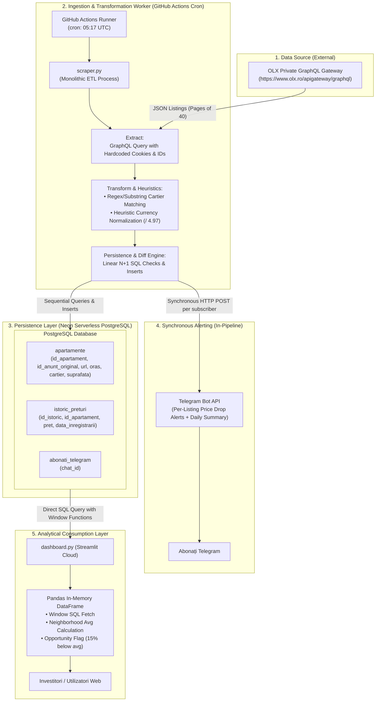

# Arhitectura Tehnică curentă - Flip Finder Platform

> **Document Status**: Audit Tehnic As-Is (Versiunea Curentă)  
> **Autor**: Senior Backend & Data Platform Architect  
> **Data**: Octombrie 2026  
> **Repository**: `flip-finder`

---

## 1. Prezentare Generală a Sistemului (System Overview)

**Flip Finder** este conceput ca o platformă de inteligență imobiliară (Real Estate Data Platform) axată pe detectarea oportunităților de investiție ("flip-uri" sau chilipiruri) și pe monitorizarea evoluției prețurilor pe piața imobiliară rezidențială.

În stadiul actual (*As-Is*), sistemul funcționează sub forma unui pipeline ETL procedural monolitic, orchestrat prin GitHub Actions, care persistă datele într-o bază de date relațională cloud (Neon PostgreSQL) și le expune direct către o interfață analitică Streamlit și notificări Telegram.

### Stiva Tehnologică Curentă
* **Runtime**: Python 3.11 / 3.14
* **Extragere Date (Scraping)**: `requests` interogând direct endpoint-ul privat GraphQL de la OLX România
* **Bază de Date (Storage)**: PostgreSQL 16 (Serverless Neon.tech), accesat prin driverul `psycopg2-binary`
* **Transformare & Curățare**: Python stdlib + Pandas (în dashboard)
* **Orchestrare & Scheduling**: GitHub Actions (cron zilnic: `17 5 * * *` UTC)
* **Consum & Vizualizare**: Streamlit Cloud (dashboard analitic direct conectat la PostgreSQL)
* **Alertare**: Telegram Bot API (push notifications pentru scăderi de preț și sinteză zilnică)

---

## 2. Diagramă de Arhitectură (Mermaid.js)

Fluxul de date curent evidențiază o arhitectură liniară și strâns cuplată, în care componentele de colectare, curățare, persistență și mesagerie rulează într-un singur proces:



---

## 3. Data Model & Database Schema

Schema actuală este minimală, compusă din trei tabele relaționale fără ORM sau mecanism formal de migrații (ex. Alembic).

### 3.1 DDL Curent (extras din `db_manager.py`)

```sql
-- Tabel entitate imobiliară
CREATE TABLE IF NOT EXISTS apartamente (
    id_apartament SERIAL PRIMARY KEY,
    id_anunt_original VARCHAR(100) UNIQUE NOT NULL,
    url_anunt TEXT NOT NULL,
    oras VARCHAR(50),
    cartier VARCHAR(50),
    suprafata_mp INTEGER
);

-- Tabel serie de timp (Time-series / Price Fluctuations)
CREATE TABLE IF NOT EXISTS istoric_preturi (
    id_istoric SERIAL PRIMARY KEY,
    id_apartament INTEGER REFERENCES apartamente(id_apartament),
    pret NUMERIC NOT NULL,
    data_inregistrarii TIMESTAMP DEFAULT CURRENT_TIMESTAMP
);

-- Tabel gestionare abonați bot
CREATE TABLE IF NOT EXISTS abonati_telegram (
    chat_id BIGINT PRIMARY KEY
);
```

### 3.2 Analiză Chei, Constrângeri și Indexare

| Tabel | Coloană | Tip | Constrângeri | Index Existent | Observații Arhitecturale |
| :--- | :--- | :--- | :--- | :--- | :--- |
| `apartamente` | `id_apartament` | `SERIAL` | `PRIMARY KEY` | B-Tree (Implicit PK) | Identificator intern auto-incrementat. |
| `apartamente` | `id_anunt_original` | `VARCHAR(100)` | `UNIQUE`, `NOT NULL` | B-Tree (Implicit Unique) | ID extern furnizor. Nu conține namespace-ul sursei (ex: `olx:`). |
| `apartamente` | `url_anunt` | `TEXT` | `NOT NULL` | Niciunul | Link direct către anunț. |
| `apartamente` | `oras` | `VARCHAR(50)` | - | Niciunul | Neindexat. În prezent are o singură valoare efectivă ("Bacau"). |
| `apartamente` | `cartier` | `VARCHAR(50)` | - | Niciunul | Neindexat. Filtrarea din dashboard scanează tabelul integral. |
| `apartamente` | `suprafata_mp` | `INTEGER` | - | Niciunul | Neindexat. |
| `istoric_preturi`| `id_istoric` | `SERIAL` | `PRIMARY KEY` | B-Tree (Implicit PK) | ID înregistrare istoric. |
| `istoric_preturi`| `id_apartament` | `INTEGER` | `REFERENCES apartamente` | **LIPSĂ (CRITIC)** | PostgreSQL **NU** creează automat index pe Foreign Keys! Orice JOIN sau partitionare face Seq Scan. |
| `istoric_preturi`| `pret` | `NUMERIC` | `NOT NULL` | Niciunul | Preț înregistrat. |
| `istoric_preturi`| `data_inregistrarii` | `TIMESTAMP` | `DEFAULT CURRENT_TIMESTAMP` | **LIPSĂ (CRITIC)** | Lipsă index compus `(id_apartament, data_inregistrarii DESC)`. |
| `abonati_telegram`| `chat_id` | `BIGINT` | `PRIMARY KEY` | B-Tree (Implicit PK) | Nu reține metadata (dată abonare, status activ, preferințe). |

### 3.3 Analiză Interogare Analitică (SQL Query în `dashboard.py`)

Interogarea executată la fiecare încărcare sau expirare de cache din dashboard:

```sql
WITH IstoricOrdonat AS (
    SELECT 
        id_apartament, pret,
        ROW_NUMBER() OVER(PARTITION BY id_apartament ORDER BY data_inregistrarii ASC) as rn_asc,
        ROW_NUMBER() OVER(PARTITION BY id_apartament ORDER BY data_inregistrarii DESC) as rn_desc
    FROM istoric_preturi
),
PreturiInitiale AS (
    SELECT id_apartament, pret as pret_initial FROM IstoricOrdonat WHERE rn_asc = 1
),
PreturiActuale AS (
    SELECT id_apartament, pret as pret_actual FROM IstoricOrdonat WHERE rn_desc = 1
)
SELECT 
    a.id_apartament, a.url_anunt, a.cartier, a.suprafata_mp,
    pi.pret_initial, pa.pret_actual
FROM apartamente a
JOIN PreturiInitiale pi ON a.id_apartament = pi.id_apartament
JOIN PreturiActuale pa ON a.id_apartament = pa.id_apartament;
```

**Probleme de performanță identificate**:
1. **Două funcții fereastră (`ROW_NUMBER()`) pe întreaga masă a tabelei**: Fără index pe `(id_apartament, data_inregistrarii)`, PostgreSQL efectuează sortare în memorie (`Sort` sau `External Sort` pe disk) a întregului tabel `istoric_preturi`. Pe măsură ce istoricul adună sute de mii de rânduri, timpul de răspuns va crește de la milisecunde la zeci de secunde.
2. **Denormalizare lipsă**: Informația despre *prețul curent* și *prețul inițial* ar trebui să fie menținută direct în `apartamente` (sau într-o vedere materializată reîmprospătată concurent), lăsând `istoric_preturi` strict ca audit log append-only.

---

## 4. Decizii Curente vs. Limitări Arhitecturale

### 4.1 Ingestion & Crawler Layer

* **Ce funcționează**:
  * Utilizarea GraphQL API oferă date mult mai structurate și mai ușor de consumat decât parsing-ul de HTML cu BeautifulSoup.
  * Paginarea dinamică prin offset funcționează pentru dataset-uri de dimensiuni reduse (< 1000 înregistrări).
* **Limitări majore**:
  1. **Autentificare și Sesiune Hardcodate (SPOF)**: În `scraper.py` (liniile 119-147) sunt inserate string-uri de cookie-uri reale (`PHPSESSID`, `OptanonConsent`, token-uri TCF v2) extrase manual din browser în august 2026. Dacă OLX invalidează token-ul sau modifică cerințele de handshake anti-bot, întregul pipeline eșuează instant.
  2. **Parametri de căutare rigizi (Bacău only)**: `city_id: 34959`, `region_id: 3`, `category_id: 907` sunt hardcodate adânc în dicționarul de parametri. Trecerea la un alt oraș (ex. Iași, Cluj, București) necesită resscrierea codului.
  3. **Absența mecanismelor de reziliență**:
     * Nu există retry cu Exponential Backoff & Jitter.
     * Nu există circuit breaker la erori de rețea sau rate-limiting (HTTP 429).
     * Dacă o cerere HTTP dă eroare, bucla se oprește complet (`break`), abandonând paginile rămase.
  4. **Euristici fragile de curățare a datelor**:
     * Cursul valutar `4.97` este o valoare magică fixă (hardcoded).
     * Logica `if pret_pe_mp > 4000: pret = pret / 4.97` produce falsuri pozitive catastrofale pentru apartamente ultracentrale premium / penthouse-uri reale al căror preț pe mp depășește legitim 4000€.
     * Filtrarea `suprafata < 15 or suprafata > 400` ignoră silențios date valide fără niciun fel de dead-letter queue (DLQ) sau log de rejectare.

### 4.2 Database & Data Access Layer

* **Ce funcționează**:
  * Folosirea Neon PostgreSQL asigură persistență cloud stabilă, compatibilă ACID.
  * Modelul de separare între entitatea `apartamente` și seria de timp `istoric_preturi` este o decizie conceptuală corectă.
* **Limitări majore**:
  1. **Pattern Anti-Performant N+1 la Ingestie**:
     * Pentru fiecare anunț extras, scraper-ul trimite 2 până la 4 interogări SQL individuale pe rețea:
       - `SELECT id_apartament ...`
       - `INSERT INTO apartamente ...` (dacă e nou)
       - `SELECT pret FROM istoric_preturi ORDER BY data_inregistrarii DESC LIMIT 1`
       - `INSERT INTO istoric_preturi ...` (dacă prețul a variat)
     * La 800 de anunțuri cu o latență rețea spre Neon de ~50ms, pipeline-ul pierde peste 2-3 minute doar în round-trips SQL secvențiale. Ar trebui înlocuit cu operațiuni atomice de tip **Bulk Upsert (`INSERT ... ON CONFLICT`)**.
  2. **Lipsa Connection Pooling-ului**:
     * Aplicația deschide și închide conexiuni `psycopg2` ad-hoc. Lipsa unui pool de conexiuni (SQLAlchemy Engine, `asyncpg` pool sau PgBouncer) limitează scalabilitatea și crește overhead-ul de handshake TLS.
  3. **Risc Critic de Distrugere a Datelor (`db_manager.py`)**:
     * Funcția `setup_database()` execută `DROP TABLE IF EXISTS ... CASCADE;`. Dacă acest fișier este rulat accidental în producție, tot istoricul de prețuri este șters definitiv.
  4. **Lipsa Migrațiilor**:
     * Orice adăugare de coloană (ex. camere, an construcție, etaj) necesită alterări manuale de tabele în consolă fără versionare de cod.

### 4.3 Cuplaj Strâns și Lipsa Separării Responsabilităților (Separation of Concerns)

* **Monolit Procedural**: Fișierul `scraper.py` combină în 400 de linii:
  * Apeluri HTTP către OLX
  * Curățare de string-uri specifice Bacăului
  * Persistență directă cu SQL brut
  * Polling al Telegram Bot API (`getUpdates`)
  * Trimitere sincronă de mesaje Telegram către utilizatori
* **Efecte Secundare în Ingestie**: În timpul parcurgerii buclei de persistență, dacă un preț scade, se execută un apel extern sincron către Telegram pentru toți abonații din listă. Dacă Telegram are latență sau returnează eroare, tranzacția bazei de date este blocată sau întregul batch este compromis.
* **Cuplaj Direct Frontend -> DB**: Dashboard-ul Streamlit se conectează direct cu drepturi depline la PostgreSQL și calculează metricele de business (ex. pragul de oportunitate de 15%) în memorie cu Pandas, în loc să consume un API securizat cu endpoint-uri dedicate de analiză.

---

## 5. Matricea Datoriilor Tehnice (Technical Debt Matrix)

| Categorie | Problemă Identificată | Severitate | Impact |
| :--- | :--- | :--- | :--- |
| **Securitate** | Hardcoded cookies și lipsă sanitizare parametri | **Ridicat** | Pierderea accesului la API; date expirate |
| **Integritate Date** | `DROP TABLE CASCADE` în utilitarul de DB | **Critic** | Risc de ștergere ireversibilă a datelor de producție |
| **Performanță** | Latență N+1 la salvare (sute de round-trips) | **Ridicat** | Ingestie lentă, timeout-uri în joburi CI/CD |
| **Performanță** | Lipsa indexurilor pe Foreign Key și Timestamps | **Ridicat** | Degenerare exponențială a interogărilor analitice |
| **Arhitectură** | Cuplaj strâns Crawler + DB + Telegram Alerts | **Mediu** | Imposibilitate de scalare orizontală sau testare modulară |
| **Calitate Cod** | Zero teste unitare/integrare, tipizare absentă | **Mediu** | Regresii frecvente la refactorizare |
| **Observabilitate** | Doar `print()`, fără metrici sau logare structurată | **Mediu** | Eșecurile silențioase nu pot fi depistate și alertate |

---
*Următorul pas arhitectural este prezentat în documentul complementar:* [`docs/ROADMAP.md`](file:///Users/alexflueraru/Documents/Projects/Flip%20Finder/docs/ROADMAP.md).
