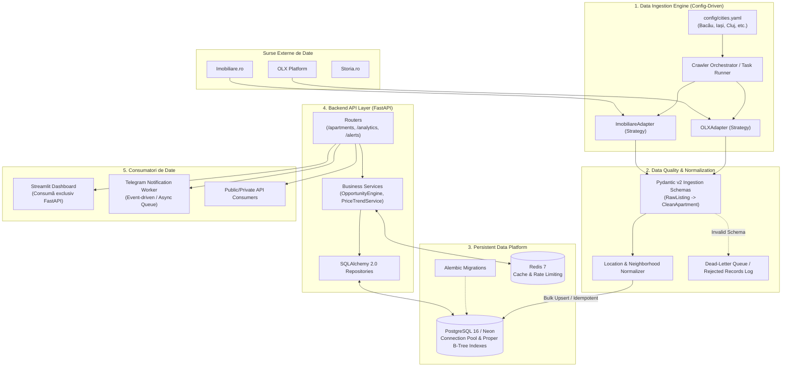

# Roadmap Tehnic: Transformarea Flip Finder în Platformă de Producție

> **Document Status**: Plan Strategic de Inginerie Software & Data Platform  
> **Autor**: Senior Backend & Data Platform Architect  
> **Data**: Octombrie 2026  
> **Target**: Trecerea de la Script ETL Monolitic la Arhitectură pe Servicii, Idempotentă și Scalabilă  

---

## 1. Arhitectura Țintă (Target State Architecture)

Viziunea finală decuplează colectarea datelor de persistență, introduce un nivel de validare strictă, oferă persistență tranzacțională optimizată și expune un **Backend API Layer (FastAPI)** ce deservește atât dashboard-ul de date, cât și serviciile de notificare:



---

## 2. Etape de Implementare Detaliate

---

### ETAPA 1: Decuplare și Config-Driven Scraping

**Obiectiv**: Eliminarea valorilor hardcodate, a cookie-urilor statice din cod și decuplarea crawler-ului de orașul Bacău și de platforma OLX.

#### 1.1 Modelul Arhitectural: Strategy Pattern & Adapters
* Se definește o clasă de bază abstractă (`BaseScraperAdapter`) folosind `abc.ABC` din Python:
  ```python
  from abc import ABC, abstractmethod
  from typing import List
  from app.schemas.scraping import RawListingPayload

  class BaseScraperAdapter(ABC):
      @abstractmethod
      async def fetch_listings(self, city_slug: str, category: str, max_pages: int = 50) -> List[RawListingPayload]:
          """Extrage anunturi folosind mecanismele specifice platformei."""
          pass
  ```
* Se implementează adaptoare dedicate:
  * `OLXGraphQLAdapter`: gestionează schema GraphQL a OLX, refresh-ul dinamic de sesiune/token și paginarea pe bază de offset.
  * `ImobiliareAdapter`: implementat pentru extinderea platformei fără a atinge logica de business.
  * `StoriaAdapter`: adaptor viitor.

#### 1.2 Configurație Externă (Config-Driven Execution)
* Se creează fișiere declarative de configurare (`config/targets.yaml` sau `config/settings.py` bazat pe `pydantic-settings`):
  ```yaml
  targets:
    - city_name: "Bacău"
      city_slug: "bacau"
      external_ids:
        olx:
          region_id: 3
          city_id: 34959
      neighborhoods_mapping: "config/neighborhoods/bacau.yaml"
    - city_name: "Iași"
      city_slug: "iasi"
      external_ids:
        olx:
          region_id: 22
          city_id: 42101
      neighborhoods_mapping: "config/neighborhoods/iasi.yaml"
  ```
* Cartierele și străzile nu mai sunt dicționare hardcodate în funcții, ci reguli declarative externalizate încărcate la inițializarea containerului.

#### 1.3 Reziliență la Nivel de Rețea
* **Sesiuni dinamice**: Eliminarea cookie-urilor `OptanonConsent` și `PHPSESSID` hardcodate. Se folosește un `HTTPClient` cu sesiune dinamică (`httpx.AsyncClient` sau `requests.Session`) care inițiază un handshake HTTP GET pentru a prelua cookie-uri proaspete dacă platforma le impune.
* **Retry cu Exponential Backoff**: Integrarea bibliotecii `tenacity` pentru reîncercarea automată a cererilor în caz de HTTP 429 (Too Many Requests), 502/503/504 sau Network Timeouts:
  ```python
  @retry(
      stop=stop_after_attempt(5),
      wait=wait_exponential(multiplier=1, min=2, max=30),
      retry=retry_if_exception_type((httpx.RequestError, httpx.HTTPStatusError))
  )
  ```
* **User-Agent Rotation & Headers Sanitization**: Configurarea unui pool de User-Agent-uri valide și eliminarea header-urilor inutile sau expirate.

---

### ETAPA 2: Data Quality & Resiliency (Ingestie Idempotentă & Audit Log)

**Obiectiv**: Asigurarea corectitudinii absolute a datelor salvate, eliminarea duplicatelor, istoricul auditat al fiecărei fluctuații de preț și eliminarea euristicilor fragile.

#### 2.1 Contracte Stricte de Validare cu Pydantic v2
* Înlocuirea dicționarelor native nestructurate (`dict`) cu modele de date Pydantic validate la runtime:
  ```python
  from pydantic import BaseModel, Field, HttpUrl, field_validator
  from decimal import Decimal
  from datetime import datetime
  from typing import Optional

  class RawListingSchema(BaseModel):
      external_id: str
      platform: str = "olx"
      url: HttpUrl
      title: str
      description: Optional[str] = ""
      raw_price: Decimal = Field(..., gt=0)
      raw_currency: str
      surface_sqm: int = Field(..., ge=10, le=1000)
      city: str
      district_raw: Optional[str] = None

  class CleanApartmentSchema(BaseModel):
      platform: str
      external_id: str
      url: str
      title: str
      city: str
      neighborhood: str
      surface_sqm: int
      price_eur: Decimal
      price_per_sqm: Decimal
      rooms: Optional[int] = None
      floor: Optional[str] = None
  ```
* **Eliminarea euristicilor valutare aberante**:
  * Scraper-ul curent împarte la `4.97` doar dacă prețul depășește 4000 €/mp. În noul sistem, `raw_currency` extras direct din metadatele anunțului dictează conversia valutară la cursul oficial BNR al zilei.
  * Orice anunț care eșuează validarea (ex. suprafață < 10 mp sau preț <= 0) este rutat către un logger de date invalidate (**Dead-Letter Record**), prevenind oprirea necontrolată a pipeline-ului.

#### 2.2 Migrarea Bazei de Date cu Alembic & Noua Schemă Normalizată
* Introducerea **Alembic** pentru versionarea schemelor.
* **Schema SQL Recondiționată**:
  * Adăugare chei unice compuse: `UNIQUE(platform, external_id)`.
  * Adăugare coloane denormalizate pe entitatea principală: `current_price`, `initial_price`, `price_per_sqm`, `status` (`ACTIVE`, `SOLD`, `DELISTED`), `first_seen_at`, `last_seen_at`.
  * Indexare B-Tree obligatorie:
    ```sql
    CREATE INDEX idx_apartamente_city_neighborhood ON apartamente(oras, cartier);
    CREATE INDEX idx_apartamente_status ON apartamente(status);
    CREATE INDEX idx_istoric_apartament_data ON istoric_preturi(id_apartament, data_inregistrarii DESC);
    ```

#### 2.3 Ingestie Idempotentă prin Bulk Upsert
* Înlocuirea celor sute de interogări SQL N+1 din bucla curentă cu o operațiune unică de **Bulk Upsert** nativă PostgreSQL (`INSERT ... ON CONFLICT DO UPDATE`):
  ```sql
  INSERT INTO apartamente (platform, external_id, url_anunt, oras, cartier, suprafata_mp, pret_curent, updated_at)
  VALUES (:platform, :external_id, :url, :oras, :cartier, :suprafata_mp, :pret_curent, NOW())
  ON CONFLICT (platform, external_id) DO UPDATE SET
      pret_curent = EXCLUDED.pret_curent,
      updated_at = NOW(),
      status = 'ACTIVE'
  RETURNING id_apartament, (xmax = 0) AS is_inserted, pret_curent;
  ```
* Salvarea istoricului de preț se face exclusiv pentru apartamentele la care `pret_curent != previous_price`, inserând un eveniment de audit în `istoric_preturi` (`delta_amount`, `delta_percentage`).
* **Decuplarea notificărilor**: Ingestia în baza de date **NU** mai apelează direct API-ul de Telegram. Pipeline-ul emite evenimente de domeniu (`PriceDroppedEvent`), salvate într-o coadă de evenimente (PostgreSQL table outbox sau Redis Stream), consumate asincron de un worker separat.

---

### ETAPA 3: Backend API Layer (FastAPI)

**Obiectiv**: Crearea unui strat de servicii REST modern, securizat și performant, care ascunde baza de date în spatele unei arhitecturi curate pe straturi și furnizează logica de calcul a investițiilor imobiliare.

#### 3.1 Arhitectura pe Straturi (Clean Layered Architecture)
Sistemul se organizează conform principiului de decuplare a responsabilităților:
* **Routers (`app/api/v1/`)**: Definirea contractelor HTTP, validarea parametrilor de intrare cu Pydantic, serializarea răspunsurilor și gestionarea codurilor de stare.
* **Services (`app/services/`)**: Logica de afaceri pură:
  * `OpportunityService`: algoritm de detecție a ofertelor sub piață.
  * `AnalyticsService`: calculul mediilor, medianelor și deviațiilor standard pe cartiere.
  * `AlertService`: gestionarea pragurilor de alertă pentru utilizatori.
* **Repositories (`app/repositories/`)**: Accesul la persistență prin **SQLAlchemy 2.0 (Async Engine)** sau interogări optimizate cu `asyncpg`, utilizând un Connection Pool robust (`pool_size=20`, `max_overflow=10`).

#### 3.2 Endpoint-uri Principale

1. **Gestiune Anunțuri & Filtrare**:
   * `GET /api/v1/apartments`:
     * Filtre: `city`, `neighborhood`, `min_price`, `max_price`, `min_surface`, `rooms`, `sort_by`.
     * Paginare standardizată (Limit & Offset sau Cursor Pagination) cu metadata: `{ "items": [...], "total": 850, "page": 1, "size": 50 }`.
   * `GET /api/v1/apartments/{id}`:
     * Detaliu complet al proprietății împreună cu tot graficul său de fluctuații de preț (`price_history`).

2. **Analytics & Detectare Oportunități ("Flips / Chilipiruri")**:
   * `GET /api/v1/analytics/opportunities`:
     * Înlocuirea formulei naive din frontend (`pret_mp < medie * 0.85`) cu un algoritm statistic robust:
       * Calculul **Medienei** și al **Deviației Standard (Z-score)** pe cartier și pe tip de compartimentare (număr de camere).
       * Filtrarea valorilor aberante (Outlier Elimination folosind IQR - Interquartile Range).
       * Calculul scorului de chilipir:
         $$\text{Score} = \frac{\text{Preț Mediu Zonă} - \text{Preț Ofertă}}{\text{Preț Mediu Zonă}} \times 100$$
   * `GET /api/v1/analytics/market-summary`:
     * Preț mediu pe mp pe cartier, stocul de oferte active, numărul de scăderi din ultimele 7/30 de zile.
   * `GET /api/v1/analytics/price-drops`:
     * Lista scăderilor de preț din ultimele 24-48 ore, ordonată după procentul sau valoarea reducerii.

3. **Gestiune Notificări & Abonați**:
   * `POST /api/v1/subscriptions`: Abonare canal notificări cu criterii de filtrare (ex: doar oferte din centrul orașului sub 70.000€).
   * `POST /api/v1/webhooks/telegram`: Webhook real pentru Telegram Bot (înlocuiește polling-ul zilnic arhaic din script).

#### 3.3 Caching & Accelerație cu Redis
* Integrarea **Redis 7**:
  * **Cache-Aside Pattern** pentru endpoint-urile analitice scumpe (`/analytics/opportunities`, `/analytics/market-summary`) cu un TTL configurabil (ex: 30-60 minute).
  * **Cache Invalidation**: La finalul fiecărui ciclu de ingestie a datelor, worker-ul emite o invalidare de tag/cheie pe Redis (`DEL cache:analytics:*`), garantând că utilizatorii primesc date proaspete imediat după scrape.
  * **Rate Limiting**: Protejarea endpoint-urilor publice împotriva abuzurilor prin token-bucket (`slowapi` sau Redis rate limiter).

---

### ETAPA 4: Production Standards (Containerizare, Testare & CI/CD)

**Obiectiv**: Standardizarea mediilor de dezvoltare și producție, garantarea stabilității prin teste automate și implementarea unui pipeline de livrare continuă (CI/CD).

#### 4.1 Containerizare cu Docker & `docker-compose.yml`
Construirea unui mediu complet reproductibil local și în cloud printr-un `docker-compose.yml` compus din servicii izolate:
* **`api`**: Aplicația FastAPI rulată cu `uvicorn` (multi-worker în producție).
* **`worker`**: Scheduler / Worker pentru crawling periodic (sau Celery / APScheduler / Cron container).
* **`dashboard`**: Aplicația Streamlit configurată să consume exclusiv API-ul intern, fără credențiale directe la baza de date.
* **`db`**: PostgreSQL 16 (pentru mediu de test și dezvoltare locală).
* **`redis`**: Instanță Redis 7 pentru caching și cozi de mesaje.

Exemplu schelet `docker-compose.yml`:
```yaml
version: '3.8'

services:
  api:
    build:
      context: .
      dockerfile: docker/Dockerfile.api
    ports:
      - "8000:8000"
    env_file: .env
    depends_on:
      db:
        condition: service_healthy
      redis:
        condition: service_started

  worker:
    build:
      context: .
      dockerfile: docker/Dockerfile.worker
    env_file: .env
    depends_on:
      - api
      - db
      - redis

  dashboard:
    build:
      context: .
      dockerfile: docker/Dockerfile.dashboard
    ports:
      - "8501:8501"
    environment:
      - API_URL=http://api:8000
    depends_on:
      - api

  db:
    image: postgres:16-alpine
    environment:
      POSTGRES_DB: flip_finder
      POSTGRES_USER: postgres
      POSTGRES_PASSWORD: postgrespassword
    ports:
      - "5432:5432"
    volumes:
      - postgres_data:/var/lib/postgresql/data
    healthcheck:
      test: ["CMD-SHELL", "pg_isready -U postgres"]
      interval: 5s
      timeout: 5s
      retries: 5

  redis:
    image: redis:7-alpine
    ports:
      - "6379:6379"

volumes:
  postgres_data:
```

#### 4.2 Test Suite Automatizat (`pytest`)
Implementarea unei piramide complete de testare:
* **Unit Tests**:
  * Validarea modelelor Pydantic cu payload-uri reale OLX (cazuri normale, cazuri de graniță, date corupte).
  * Testarea funcțiilor matematice ale `OpportunityService` (Z-score, IQR, excluderea extremelor).
  * Testarea matcher-ului de cartiere pe string-uri curate și murdare.
* **Integration Tests**:
  * Utilizarea `testcontainers-python` sau a unei baze Postgres locale efemere pentru a testa operațiunile de **Bulk Upsert**, constrângerile de unicitate și migrațiile Alembic.
  * Mock-uirea apelurilor HTTP externe (`httpx_mock` sau `respx`) pentru a valida adaptorele de crawling fără a atinge rețeaua externă.
* **API Tests**:
  * Testarea endpoint-urilor FastAPI folosind `httpx.AsyncClient` (`TestClient`).

#### 4.3 Pipeline CI/CD Modern (GitHub Actions)
Reconfigurarea workflow-ului din `.github/workflows/` într-o suită strictă de validare la fiecare `push` și `pull_request`:
* **Linting & Code Formatting**: `ruff check .` și `ruff format --check` (execuție ultrarapidă în Rust).
* **Static Type Checking**: `mypy --strict app/` (garantează eliminarea erorilor de tipuri la runtime).
* **Security & Vulnerability Audit**: `pip-audit` sau `bandit` pentru depistarea pachetelor compromise.
* **Test Automation**: Rulare `pytest -v --cov=app --cov-report=xml --cov-fail-under=80`.
* **Automated Migration Check**: Rulare `alembic check` pentru a preveni deviațiile de schemă neînregistrate.

---

## 3. Plan de Migrare Fără Întreruperea Serviciului (Zero-Downtime Migration)

| Fază | Focus Principal | Livrabile Cheie | Dependențe |
| :--- | :--- | :--- | :--- |
| **Săptămâna 1** | Decuplare & Validare Date | Modele Pydantic v2, `BaseScraperAdapter`, `config/targets.yaml`, eliminare cookie-uri hardcodate. | - |
| **Săptămâna 2** | Persistență Robustă & Alembic | Migrare Alembic pe Neon DB, indexuri pe FK/Timestamps, Bulk Upsert idempotent, eliminare N+1. | Săptămâna 1 |
| **Săptămâna 3** | Backend FastAPI & Analytics | Stratul Router-Service-Repository, endpoint-uri de Oportunități & Flips, integrare Redis Cache. | Săptămâna 2 |
| **Săptămâna 4** | Refactorizare Consumatori | Streamlit actualizat să apeleze FastAPI, Telegram Webhook/Worker decuplat, Docker Compose & CI complet. | Săptămâna 3 |

---
*Document corelat cu analiza sistemului existent:* [`docs/ARCHITECTURE.md`](file:///Users/alexflueraru/Documents/Projects/Flip%20Finder/docs/ARCHITECTURE.md).
